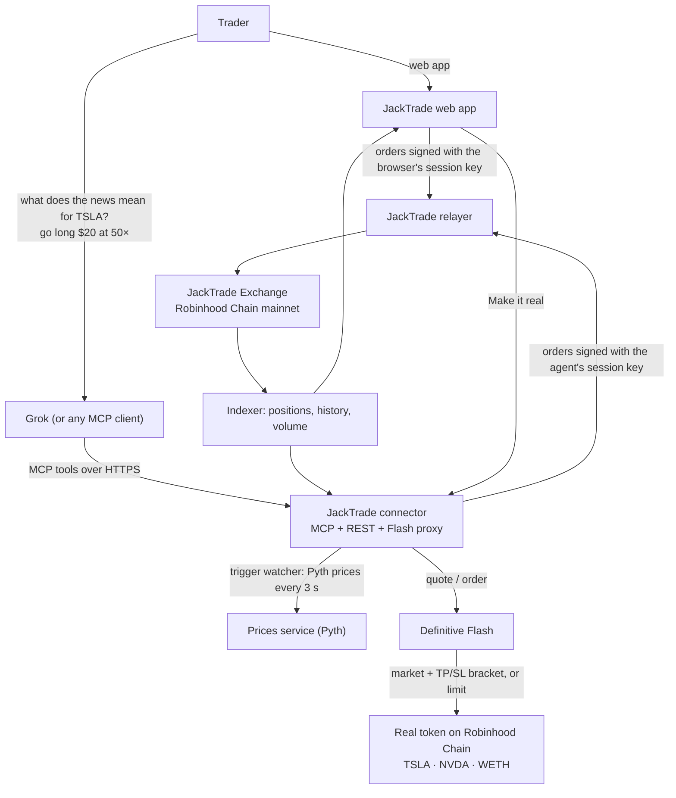
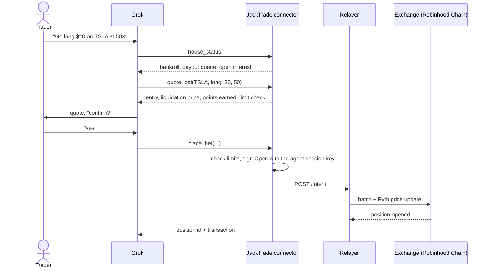

<p align="center"></p>

# JackTrade

> **Markets, on command.** Go long or short on US stock tokens and crypto with up to 1000× leverage on Robinhood Chain. Place the trade yourself, or tell your AI agent to: add JackTrade to Grok once and it can check the house, quote, trade, set price alerts that trade for you, and cash out, right in the chat.

- **Live app**: [jacktrade.up.railway.app](https://jacktrade.up.railway.app)
- **Spec**: [`docs/spec.md`](docs/spec.md) · **Demo runbook**: [`docs/demo-runbook.md`](docs/demo-runbook.md) · **Submission copy**: [`docs/submission.md`](docs/submission.md)
- **What existed before the hackathon**: [`PRE-EXISTING.md`](PRE-EXISTING.md) · **AI usage**: [`docs/AI_USAGE.md`](docs/AI_USAGE.md)
- **Code**: [`web`](web) (trading app) · [`connector`](connector) (Grok / MCP connector) · [`contracts`](contracts) (JackTrade Points) · [`backend`](backend) (prices, relayer, Ponder indexer, keepers, liquidator)

---

## The problem

People already use Grok to make sense of the news. They ask what tariffs mean for Tesla, Grok reads X and the headlines, and they form a view. Then they leave to trade: open another app, find the ticker, size the position. By the time they get there the moment is gone, and outside the US most of them can't get leverage on US stocks at all.

## What JackTrade is

A bet-against-the-house exchange on Robinhood Chain that people and AI agents use the same way.

- **For traders**: a trading terminal. Pick a market, long or short, margin and leverage (10× to 1000×). No order book: the house takes the other side at the Pyth oracle price.
- **For agents**: a remote MCP server. Add it to Grok (or Claude, ChatGPT, any MCP client) and the agent gets tools to check the house, quote, trade, arm conditional trades and cash out. Its key can trade but **never withdraw**, inside limits you set.
- **For followers**: every agent trade lands in a public feed, and anyone can **make it real**, copying the call into the actual stock token with one Definitive Flash order, take-profit and stop-loss attached.
- **For everyone**: **JackTrade Points**, 10 per $100 traded, win or lose.

Picture a trader in Kuala Lumpur who follows Tesla on X. They can hold US stock tokens onchain but can't put leverage on them. They ask Grok what this week's headlines mean for Tesla, decide, and say "go long $20 at 50×". Grok checks the house, quotes the liquidation price, and places the trade in seconds. Or: "if TSLA drops below $350, short it at 20× with $20", and JackTrade fires it the moment the price crosses, even while they sleep.

## How a trade works

```
position size     = margin × leverage                         (min $10 margin, up to 1000×)
liquidation move  ≈ 1 / leverage − 0.05%                      (50× → ~1.95% against you)
points earned     = position size × 10 / 100                  (win or lose)
```

- **You lose** → your margin (or the part the move ate) goes to the house bankroll.
- **You win** → you're paid from the house bankroll. If a win is bigger than the bankroll, the rest waits in a first-in-first-out payout queue that refills as the house earns. Nothing is lost; it's paid in order.
- **The house is solvent by construction**: it only pays out what it holds or has queued. Anyone can watch the bankroll, queue and open interest on the House page, and agents read them with `house_status` before trading.

## Safety model

| Risk | How JackTrade handles it |
|------|--------------------------|
| An AI agent holding trading keys | The agent gets a **session key** on the exchange's SessionKeyManager: it can open and close trades but can **never withdraw**. You revoke it from your wallet any time. |
| Session keys have no onchain size limits | The connector enforces your caps **before signing**: max per trade, max leverage and a 24-hour loss budget. Conditional trades go through the same checks when they fire. |
| Key storage | Agent keys are generated server-side and stored **AES-256-GCM encrypted**; connector URL tokens are stored hashed. |
| An agent trading without being asked | The tools tell the agent to quote first and get explicit confirmation before `place_bet` or `set_trigger`. |
| Can the house pay? | `house_status` returns the live bankroll, payout queue and open interest. |
| The web app in someone else's frame | The app refuses to run inside an iframe (a session key can trade without a wallet prompt). |

## The agent tools

| Tool | What it does |
|------|--------------|
| `list_markets` | Markets with live prices and max leverage |
| `house_status` | Bankroll, payout queue and open interest |
| `quote_bet` | Entry, position size, liquidation price and limit check, without trading |
| `place_bet` | Opens the trade, after the user confirms |
| `my_bets` | Open trades with live PnL and liquidation prices |
| `cash_out` | Closes a trade at the current price |
| `set_trigger` | Arms a trade that fires when the price crosses a level |
| `list_triggers` / `cancel_trigger` | Armed and fired conditional trades; disarm one |
| `make_it_real` | Link to copy a trade into the real token with Definitive Flash |
| `my_points` | Your JackTrade Points and the top of the leaderboard |

Source: [`connector/src/tools.ts`](connector/src/tools.ts). The trigger watcher checks Pyth prices every 3 seconds and fires an armed trade through the same path as a manual one: [`connector/src/triggers.ts`](connector/src/triggers.ts).

## The web app

| Route | Page |
|-------|------|
| `/` | Landing |
| `/trade` | Trading terminal: chart, order ticket, positions |
| `/grok` | Connect Grok: approve its key (one gasless signature), set limits, copy the private MCP link, revoke |
| `/bets` | Agent bets: live feed of trades placed through the connector |
| `/real/:id` | Make it real: copy an agent's trade with a Definitive Flash order |
| `/portfolio`, `/u/:username` | Your portfolio, and public profiles |
| `/house` | The house: bankroll, payout queue, exposure, liquidation heatmap |
| `/points`, `/leaderboard` | JackTrade Points and the trader leaderboard |
| `/docs` | Help and FAQ |

React 19, TanStack Router, Vite 8, viem and wagmi / Reown AppKit. Dark only, with Jack, the mascot, as the logo. Details in [`web/README.md`](web/README.md).

## Architecture



### An agent trade



### Make it real (Definitive Flash)

A long trade becomes a Flash **market** buy with an **attached bracket** (take-profit and stop-loss, set from the trade's distance to liquidation). A short becomes a **limit** buy below the market. The follower approves and signs in their own wallet; Flash executes onchain and the real TSLA, NVDA or WETH lands in their wallet. The Flash API key stays on the connector, which proxies `/v1/quote`, `/v1/order` and `/v1/orders`. If Flash doesn't return a bracket, the app refuses to place an unprotected order.

## JackTrade Points

Every trade earns points, **win or lose**: **10 points per $100 of position size** (margin × leverage). A $20 trade at 50× is $1,000 and earns 100 points.

Points come from the exchange's onchain trade history (via the indexer), so anyone can recompute them. Agents report them with `my_points`, quotes show the points a trade will earn, and the web app ranks them at `/points`. [`contracts/`](contracts) holds `JackTradePoints`, a non-transferable onchain ledger for them (see its [README](contracts/README.md)).

## Status

| Component | Status | Where |
|-----------|--------|-------|
| Trading web app (terminal, portfolio, house, leaderboard) | **Built** · pre-existing app, rebranded and redesigned | [`web`](web) |
| Grok connector (MCP: 11 tools, limits, encrypted agent keys) | **Built** · read tools and quotes tested against the live mainnet APIs | [`connector`](connector) |
| Conditional trades (`set_trigger`) | **Built** | [`connector/src/triggers.ts`](connector/src/triggers.ts) |
| Connect Grok (gasless session-key registration) | **Built** | [`web/src/routes/grok.jsx`](web/src/routes/grok.jsx) |
| Agent bets feed | **Built** | [`web/src/routes/bets.jsx`](web/src/routes/bets.jsx) |
| Make it real (Definitive Flash market + bracket, limit) | **Built** · live Flash quotes with an attached bracket verified | [`web/src/routes/real.jsx`](web/src/routes/real.jsx) |
| JackTrade Points (connector + leaderboard) | **Built** · verified against live mainnet volume | [`connector/src/points.ts`](connector/src/points.ts) |
| JackTradePoints contract | **Live on Robinhood Chain** · 19 Foundry tests | [`contracts`](contracts) |
| Points sync | **Live** · credited 215 JTP onchain for a test wallet's $2,150 of notional | [`connector/src/pointsSync.ts`](connector/src/pointsSync.ts) |
| Fresh exchange deployment | **Live** · deployed and configured from block 107978288, losses mint nothing, points instead | see Deployments |
| JackTrade backend (prices, relayer, Ponder indexer, keepers, liquidator) | **Live** on Railway | [`backend`](backend) |
| End-to-end on mainnet | **Verified** · gasless deposit, Connect Grok, ETH and TSLA bets placed and cashed out through the MCP tools | [`connector/test/e2e.live.ts`](connector/test/e2e.live.ts) |
| Single-image deploy (connector + web) | **Built** · one Docker image serves both | [`Dockerfile`](Dockerfile) |

## Deployments

**Robinhood Chain mainnet (chain id 4663)**, deployed during the hackathon:

| Contract | Address |
|----------|---------|
| Exchange | `0x70760d6e91fb6ec71c5999c196ecef4471f6ac4c` |
| BatchExecutor | `0x9221254c99f4b15886b204116f979acebdcddec2` |
| SessionKeyManager | `0x4918923b2927bf250ffac5fdcbee3f3eedb2c0af` |
| PriceOracle (Pyth) | `0x35367e32bf94d9abe8af29a38323536b876ae51f` |
| NoMintTokenomics (losses mint nothing) | `0x506b4124d2f63b83c147b026ebc7fa004683ddea` |
| JackTradePoints (JTP) | `0xdc4d5b817C3Df2fB19cE5856b3967FbFA1199Ed7` |
| Collateral: USDG | `0x5fc5360D0400a0Fd4f2af552ADD042D716F1d168` |

**Tokens used by Make it real (Robinhood Chain):** TSLA `0x322F0929c4625eD5bAd873c95208D54E1c003b2d` · NVDA `0xd0601CE157Db5bdC3162BbaC2a2C8aF5320D9EEC` · WETH `0x0Bd7D308f8E1639FAb988df18A8011f41EAcAD73`

## Repository layout

```
jacktrade/
├── web/          # trading app: terminal, portfolio, house, points, leaderboard, agent pages (React 19 + Vite 8)
├── connector/    # remote MCP server for Grok + REST API + trigger watcher + Flash proxy; serves the built web app
├── backend/      # prices, relayer, Ponder indexer, keepers, liquidator (imported, redeployed for JackTrade)
├── contracts/    # JackTradePoints (Foundry): non-transferable onchain points ledger, tests, deploy script
├── docs/         # spec, demo runbook, submission copy, prompts
├── Dockerfile    # one image: connector + built web app
└── PRE-EXISTING.md
```

## Quickstart

One service runs everything:

```bash
docker build -t jacktrade .
docker run -p 8787:8787 -v jacktrade:/data \
  -e SERVER_SECRET=$(openssl rand -hex 32) \
  -e PUBLIC_URL=http://localhost:8787 \
  -e FLASH_API_KEY=<your Flash key> \
  jacktrade
```

Open http://localhost:8787, go to **Grok**, and follow the steps to paste your private link into grok.com → Connectors.

### Development

Two processes: the connector on :8787 and the web app on :8018.

```bash
cd connector && npm install && cp .env.example .env    # set SERVER_SECRET (openssl rand -hex 32)
node --env-file=.env --watch src/server.ts              # http://localhost:8787
```

```bash
cd web && bun install --frozen-lockfile && bun run dev  # http://127.0.0.1:8018
```

The web app uses the production exchange services by default and the local connector in development. Checks:

```bash
cd web && bun run check            # lint, tests, production build
cd connector && npm run typecheck # connector: TypeScript check
cd contracts && forge test -vv     # JackTradePoints: 19 tests
```

## Tech stack

| Layer | Choice |
|-------|--------|
| Agent interface | MCP (Streamable HTTP, stateless) via `@modelcontextprotocol/sdk`, added to Grok as a custom connector |
| Connector | Node 24 + TypeScript (native type stripping), Express 5, viem, `node:sqlite` |
| Web app | React 19, TanStack Router, Vite 8, Tailwind CSS 3, viem + wagmi, Reown AppKit |
| Advanced orders | Definitive Flash API (market + attached bracket, limit) on Robinhood Chain |
| Points contract | Solidity 0.8, Foundry, no external dependencies |
| Exchange | JackTrade bet-against-the-house contracts on Robinhood Chain mainnet, USDG collateral, Pyth prices |
| Deploy | Single Docker image on Railway |

## Continuity Track

This is a Continuity Track project. JackTrade's exchange and its trading app existed before the hackathon; see [`PRE-EXISTING.md`](PRE-EXISTING.md) for exactly what was reused and what was built during the event, and [`docs/AI_USAGE.md`](docs/AI_USAGE.md) for how AI tools were used.
