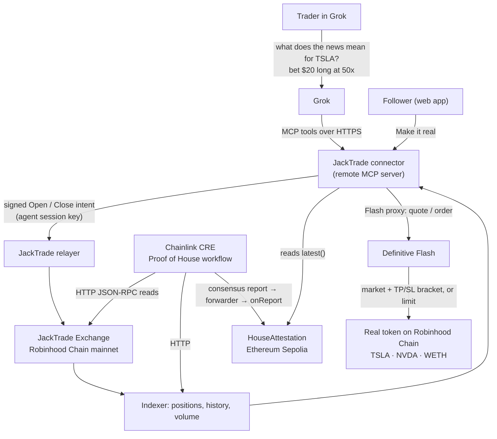

# JackTrade

> **Let Grok trade the news.** Ask Grok what the headlines mean for a stock, say "bet $20 long TSLA at 50x", and JackTrade places a leveraged bet against the house onchain, from inside the chat. Followers can make it real with a Definitive Flash order, and a Chainlink CRE workflow proves the house can pay.

- **Spec** (source of truth): [`docs/spec.md`](docs/spec.md)
- **Demo runbook**: [`docs/demo-runbook.md`](docs/demo-runbook.md) · **Submission copy**: [`docs/submission.md`](docs/submission.md)
- **What existed before the hackathon**: [`PRE-EXISTING.md`](PRE-EXISTING.md) · **AI usage**: [`docs/AI_USAGE.md`](docs/AI_USAGE.md)
- **Grok connector**: [`connector`](connector) · **Web app**: [`web`](web) · **Chainlink CRE**: [`cre`](cre)

---

## The problem

Millions of people already use Grok to make sense of the news. They ask what tariffs mean for Tesla, Grok reads X and the headlines, and they form a view. Then they leave Grok to trade: open a brokerage app, find the ticker, size the position. By the time they get there, the moment is gone, and outside the US most of them can't get leverage on US stocks at all.

The research happens in one place and the trade happens somewhere else.

## The solution

JackTrade puts the trade where the research already happens. It's a **Grok connector**: add it once at grok.com → Connectors, and Grok can check the house, quote a leveraged bet, place it onchain, track it and cash out, all in the same conversation.

Picture a retail trader in Kuala Lumpur. US stock tokens trade onchain on Robinhood Chain, but there's no simple way to put leverage on them. They ask Grok what this week's headlines mean for Tesla, and Grok answers with the posts and news behind its view. They say "bet $20 long TSLA at 50x". Grok checks that the house is good for it, quotes the liquidation price, and places the bet on JackTrade in seconds.

- **The trader** bets against the house with leverage, from the chat. Grok's key can open and close bets but can **never withdraw**, and the trader sets its limits.
- **Followers** see every Grok bet in a public feed and can **make it real**: copy the call into the real stock token with one Definitive Flash order, take-profit and stop-loss attached.
- **The house** is the counterparty. A Chainlink CRE workflow attests its bankroll onchain, and Grok reads that attestation before every bet.
- **Everyone earns JackTrade Points**: 10 points per $100 of notional, win or lose.

## How a bet works

JackTrade's exchange is a bet-against-the-house venue: no order book, no counterparty matching. You post margin, pick leverage, and the house takes the other side at the oracle price (Pyth).

```
notional          = margin × leverage                       (min $10 margin, up to 1000x)
liquidation move  ≈ 1 / leverage − 0.05%                    (50x → ~1.95% against you)
points earned     = notional × 10 / 100                     (win or lose)
```

- **You lose** → your margin (or the part the move ate) goes to the house bankroll.
- **You win** → you're paid from the house bankroll. If a win is bigger than the bankroll, the rest waits in a first-in-first-out payout queue that refills as the house earns. Nothing is lost; it's paid in order.
- **The house is solvent by construction**: it only ever pays out what it holds or has queued. Proof of House (Chainlink CRE) publishes that bankroll and queue onchain.

## Safety model

| Risk | How JackTrade handles it |
|------|--------------------------|
| An AI agent holding trading keys | Grok gets a **session key** on the exchange's SessionKeyManager: it can open and close bets but can **never withdraw**. The user revokes it from their wallet any time. |
| Session keys have no onchain size limits | The connector enforces the user's caps **before signing**: max bet, max leverage, and a 24-hour risk budget. |
| Key storage | Agent keys are generated server-side and stored **AES-256-GCM encrypted**; connector URL tokens are stored hashed. |
| Grok betting without being asked | The connector instructs Grok to quote first and get explicit confirmation before `place_bet`. |
| Can the house pay? | `house_status` returns the live bankroll, payout queue and the latest **Chainlink-attested** Proof of House. |

## Integrations

| Component | What it does | Where |
|-----------|--------------|-------|
| **Grok (xAI) connectors** | Grok calls JackTrade's tools over MCP: `list_markets`, `house_status`, `quote_bet`, `place_bet`, `my_bets`, `cash_out`, `my_points`, `make_it_real` | [`connector/src/tools.ts`](connector/src/tools.ts) |
| **Definitive Flash** | "Make it real": a long bet becomes a `market` order with an `attachedBracket` (take-profit / stop-loss); a short becomes a `limit` buy, on the real Robinhood Chain token | [`web/src/pages/Real.jsx`](web/src/pages/Real.jsx) · proxy in [`connector/src/server.ts`](connector/src/server.ts) |
| **Chainlink CRE** | Proof of House: reads the house's bankroll and payout queue from Robinhood Chain + open interest from the indexer → DON consensus → `HouseAttestation` onchain | [`cre/proof-of-house`](cre/proof-of-house) · [`cre/contracts`](cre/contracts) |
| **JackTrade exchange** (pre-existing) | Bet-against-the-house contracts, relayer and indexer on Robinhood Chain mainnet | [`PRE-EXISTING.md`](PRE-EXISTING.md) |

## Architecture


