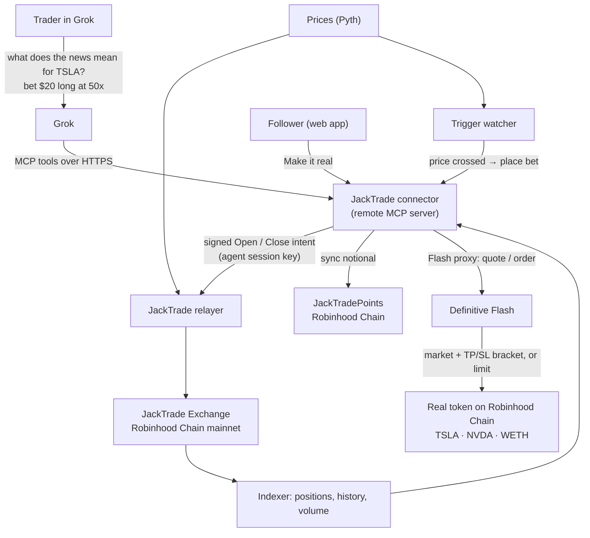
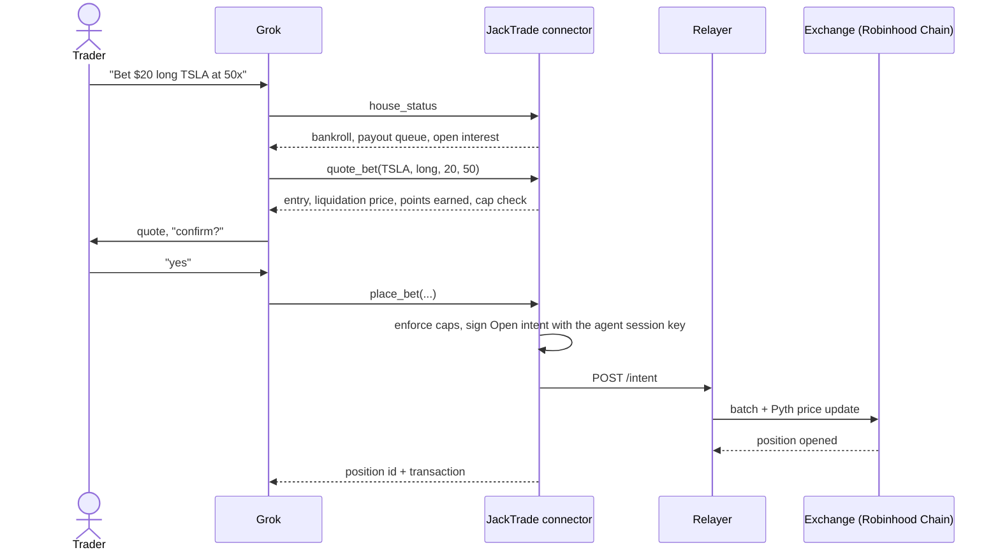
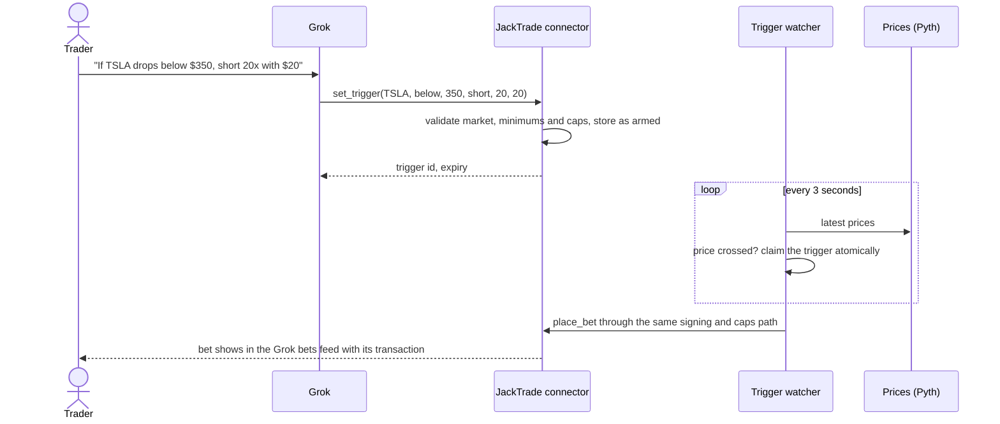
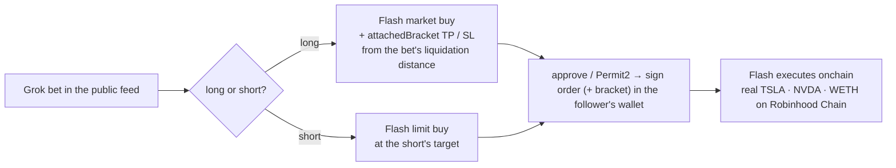

# JackTrade

> **Let Grok trade the news.** Ask Grok what the headlines mean for a stock, say "bet $20 long TSLA at 50x", and JackTrade places a leveraged bet against the house onchain, from inside the chat. Grok can also watch a level and fire the bet when the price crosses. Followers can make it real with one Definitive Flash order.

- **Live app**: [jacktrade-production.up.railway.app](https://jacktrade-production.up.railway.app) (Connect Grok · Grok bets · Points · Make it real)
- **Spec** (source of truth): [`docs/spec.md`](docs/spec.md)
- **Demo runbook**: [`docs/demo-runbook.md`](docs/demo-runbook.md) · **Submission copy**: [`docs/submission.md`](docs/submission.md)
- **What existed before the hackathon**: [`PRE-EXISTING.md`](PRE-EXISTING.md) · **AI usage**: [`docs/AI_USAGE.md`](docs/AI_USAGE.md)
- **Grok connector**: [`connector`](connector) · **Web app**: [`web`](web) · **Points contract**: [`contracts`](contracts) · **Backend**: [`backend`](backend)

---

## The problem

Millions of people already use Grok to make sense of the news. They ask what tariffs mean for Tesla, Grok reads X and the headlines, and they form a view. Then they leave Grok to trade: open a brokerage app, find the ticker, size the position. By the time they get there, the moment is gone, and outside the US most of them can't get leverage on US stocks at all.

The research happens in one place and the trade happens somewhere else.

## The solution

JackTrade puts the trade where the research already happens. It's a **Grok connector**: add it once at grok.com → Connectors, and Grok can check the house, quote a leveraged bet, place it onchain, track it and cash out, all in the same conversation.

Picture a retail trader in Kuala Lumpur. US stock tokens trade onchain on Robinhood Chain, but there's no simple way to put leverage on them. They ask Grok what this week's headlines mean for Tesla, and Grok answers with the posts and news behind its view. They say "bet $20 long TSLA at 50x". Grok checks that the house is good for it, quotes the liquidation price, and places the bet on JackTrade in seconds.

- **The trader** bets against the house with leverage, from the chat. Grok's key can open and close bets but can **never withdraw**, and the trader sets its limits.
- **Followers** see every Grok bet in a public feed and can **make it real**: copy the call into the real stock token with one Definitive Flash order, take-profit and stop-loss attached.
- **Grok can act while you're away**: arm a conditional bet ("short TSLA 20x with $20 if it drops below $350") and JackTrade fires it the moment the price crosses.
- **The house** is the counterparty. Grok checks its live bankroll and payout queue before every bet.
- **Everyone earns JackTrade Points**: 10 points per $100 of notional, win or lose.

## How a bet works

JackTrade's exchange is a bet-against-the-house venue: no order book, no counterparty matching. You post margin, pick leverage, and the house takes the other side at the oracle price (Pyth).

```
notional          = margin × leverage                       (min $10 margin, up to 1000x)
liquidation move  ≈ 1 / leverage − 0.05%                    (50x → ~1.95% against you)
points earned     = notional × 10 / 100                     (win or lose)
```

- **You lose** → your margin (or the part the move ate) goes to the house bankroll.
- **You win** → you're paid from the house bankroll. If a win is bigger than the bankroll, the rest waits in a first-in-first-out payout queue that refills as the house earns. Nothing is lost; it's paid in order.
- **The house is solvent by construction**: it only ever pays out what it holds or has queued, and `house_status` shows both before you bet.

## Safety model

| Risk | How JackTrade handles it |
|------|--------------------------|
| An AI agent holding trading keys | Grok gets a **session key** on the exchange's SessionKeyManager: it can open and close bets but can **never withdraw**. The user revokes it from their wallet any time. |
| Session keys have no onchain size limits | The connector enforces the user's caps **before signing**: max bet, max leverage, and a 24-hour risk budget. |
| Key storage | Agent keys are generated server-side and stored **AES-256-GCM encrypted**; connector URL tokens are stored hashed. |
| Grok betting without being asked | The connector instructs Grok to quote first and get explicit confirmation before `place_bet`. |
| Can the house pay? | `house_status` returns the live bankroll, payout queue and open interest before every bet. |
| A trigger firing twice | Each armed trigger is claimed atomically before it fires, and it goes through the same caps as a manual bet. |

## Integrations

| Component | What it does | Where |
|-----------|--------------|-------|
| **Grok (xAI) connectors** | Grok calls JackTrade's tools over MCP: `list_markets`, `house_status`, `quote_bet`, `place_bet`, `my_bets`, `cash_out`, `set_trigger`, `list_triggers`, `cancel_trigger`, `my_points`, `make_it_real` | [`connector/src/tools.ts`](connector/src/tools.ts) |
| **Definitive Flash** | "Make it real": a long bet becomes a `market` order with an `attachedBracket` (take-profit / stop-loss); a short becomes a `limit` buy, on the real Robinhood Chain token | [`web/src/routes/real.jsx`](web/src/routes/real.jsx) · proxy in [`connector/src/server.ts`](connector/src/server.ts) |
| **Conditional bets** | A watcher checks Pyth prices every 3 seconds and fires armed bets through the same signing and caps path | [`connector/src/triggers.ts`](connector/src/triggers.ts) |
| **JackTradePoints** | Non-transferable onchain points (JTP), synced every minute from each trader's notional | [`contracts/src/JackTradePoints.sol`](contracts/src/JackTradePoints.sol) · [`connector/src/pointsSync.ts`](connector/src/pointsSync.ts) |
| **JackTrade exchange** | Bet-against-the-house contracts (pre-existing code, freshly deployed with the new points logic) plus relayer, prices and Ponder indexer | [`backend`](backend) · [`PRE-EXISTING.md`](PRE-EXISTING.md) |

## Architecture



## The bet loop



## Conditional bets



## Make it real (Definitive Flash)



The Flash API key never reaches the browser: the connector proxies `/v1/quote`, `/v1/order` and `/v1/orders`. If Flash doesn't return a bracket payload, the app refuses to place an unprotected order.

## JackTrade Points

Every bet earns points, **win or lose**: **10 points per $100 of notional** (margin × leverage). A $20 bet at 50x is $1,000 of notional and earns 100 points.

Points are computed from the exchange's onchain trade history (via the indexer), so anyone can recompute them. Grok reports them with `my_points`, every quote shows the points a bet will earn, and the web app has a leaderboard at `/points`. They're designed to carry into a future token event.

## Status

| Component | Status | Where |
|-----------|--------|-------|
| Grok connector (MCP: 8 tools, caps, encrypted agent keys) | **Built** · read tools and quotes tested against the live mainnet APIs | [`connector`](connector) |
| Connect Grok (gasless session-key registration) | **Built** | [`web/src/routes/grok.jsx`](web/src/routes/grok.jsx) |
| Make it real (Definitive Flash market + bracket, limit) | **Built** · live Flash quotes with an attached bracket verified | [`web/src/routes/real.jsx`](web/src/routes/real.jsx) |
| Proof of House (Chainlink CRE) | **Built** · workflow compiles to WASM, live-data test passes, contract 5/5 tests, report delivery verified on a Sepolia fork | [`cre`](cre) |
| JackTrade Points | **Built** · verified against live mainnet volume | [`connector/src/points.ts`](connector/src/points.ts) |
| Single-image deploy (connector + web) | **Built** · Docker image builds and serves both | [`Dockerfile`](Dockerfile) |
| Hosted deployment | **Live** · connector + web app, Flash quotes verified through the hosted proxy | [jacktrade-production.up.railway.app](https://jacktrade-production.up.railway.app) |
| CRE simulation broadcast to Sepolia | In progress | [`cre/README.md`](cre/README.md) |

## Deployments

**JackTrade exchange — Robinhood Chain mainnet (chain id 4663)**, pre-existing, used as-is:

| Contract | Address |
|----------|---------|
| Exchange | `0x698cf1a9220f89ccf6ee75269086288a623ede54` |
| SessionKeyManager | `0xe82bb6f411a9a53170f9c4fff53207eb80b7bb29` |
| BatchExecutor | `0xf612485f65e0ea7109a3eb09ea7e0abfabd167a4` |
| Collateral: USDG | `0x5fc5360D0400a0Fd4f2af552ADD042D716F1d168` |

**Built at the hackathon:**

| Contract | Chain | Address |
|----------|-------|---------|
| `HouseAttestation` (CRE `onReport` consumer) | Ethereum Sepolia | pending deploy |

**Tokens used by Make it real (Robinhood Chain):** TSLA `0x322F0929c4625eD5bAd873c95208D54E1c003b2d` · NVDA `0xd0601CE157Db5bdC3162BbaC2a2C8aF5320D9EEC` · WETH `0x0Bd7D308f8E1639FAb988df18A8011f41EAcAD73`

## Repository layout

```
jacktrade/
├── connector/            # remote MCP server (Grok connector) + REST API + Flash proxy; serves the web app
│   └── src/              # server, MCP tools, trading (intent signing), points, store, upstream clients
├── web/                  # pre-existing JackTrade exchange frontend (imported) + Connect Grok, Grok bets, Points, Make it real
├── cre/
│   ├── proof-of-house/   # Chainlink CRE workflow (TypeScript / bun)
│   └── contracts/        # HouseAttestation consumer (Foundry) + deploy script + tests
├── docs/                 # spec, demo runbook, submission copy, prompts
├── Dockerfile            # one image: connector + built web app
└── PRE-EXISTING.md       # what this builds on
```

## Quickstart

One service runs everything:

```bash
docker build -t jacktrade .
docker run -p 8787:8787 -v jacktrade:/data \
  -e SERVER_SECRET=$(openssl rand -hex 32) \
  -e PUBLIC_URL=http://localhost:8787 \
  -e FLASH_API_KEY=<your Flash key> \
  -e ATTESTATION_ADDRESS=<HouseAttestation on Sepolia> \
  jacktrade
# open http://localhost:8787 → Connect Grok → paste the connector URL into grok.com/connectors
```

Development:

```bash
cd connector && npm install && npm run dev        # env: connector/.env.example
cd web && bun install && bun run dev              # env: web/.env.example
cd cre/contracts && forge test                    # HouseAttestation: 5 tests
cd cre/proof-of-house && bun install && bun test  # workflow against live Robinhood Chain data
```

Chainlink CRE simulation (after `cre login`): see [`cre/README.md`](cre/README.md).

## Tech stack

| Layer | Choice |
|-------|--------|
| Agent interface | MCP (Streamable HTTP, stateless) via `@modelcontextprotocol/sdk`, added to Grok as a custom connector |
| Connector | Node 24 + TypeScript (native type stripping), Express 5, viem, `node:sqlite` |
| Web app | Vite + React 18 + viem (injected wallet, no wallet SDK) |
| Advanced orders | Definitive Flash API (market + attached bracket, limit) on Robinhood Chain |
| Oracle / attestation | Chainlink CRE (TypeScript SDK) → `HouseAttestation` (Solidity, Foundry) on Sepolia |
| Exchange | JackTrade bet-against-the-house contracts on Robinhood Chain mainnet, USDG collateral, Pyth prices |
| Deploy | Single Docker image on Railway |

## Continuity Track

This is a Continuity Track project. JackTrade's exchange contracts and services were live on Robinhood Chain before the hackathon; none of their source is in this repo. Everything here (connector, web app, CRE workflow and contract, points) was built during the hackathon. See [`PRE-EXISTING.md`](PRE-EXISTING.md) and [`docs/AI_USAGE.md`](docs/AI_USAGE.md).
